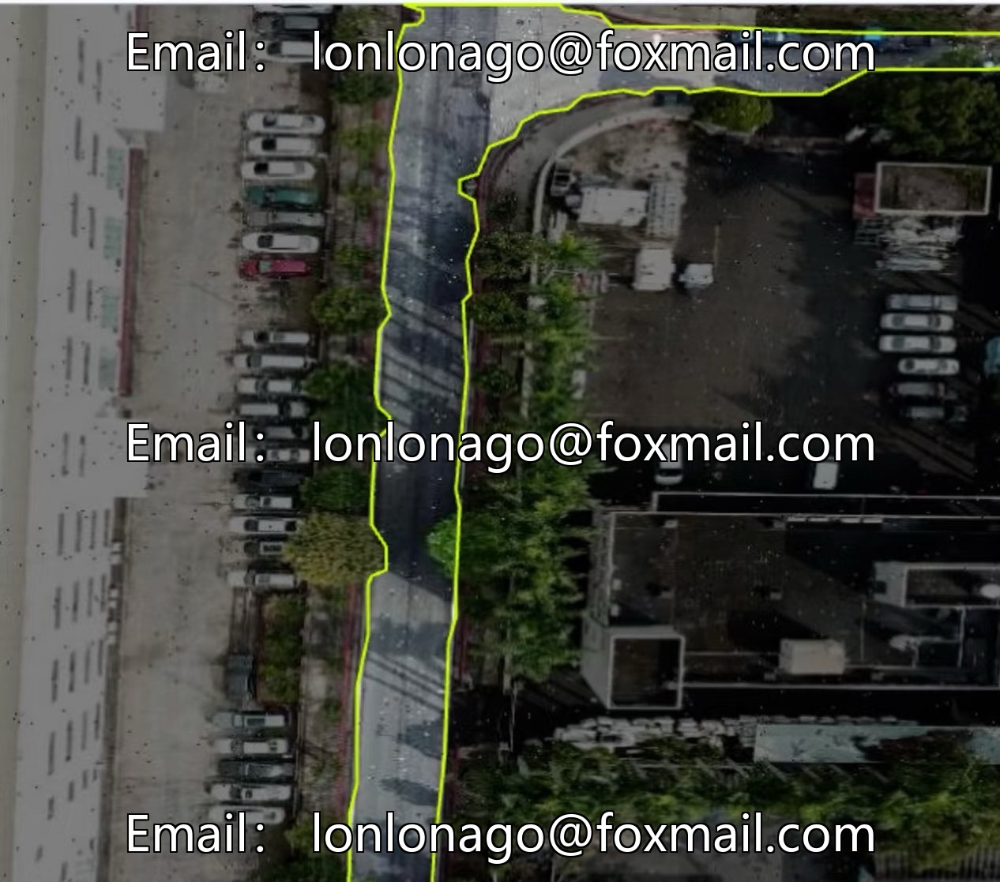
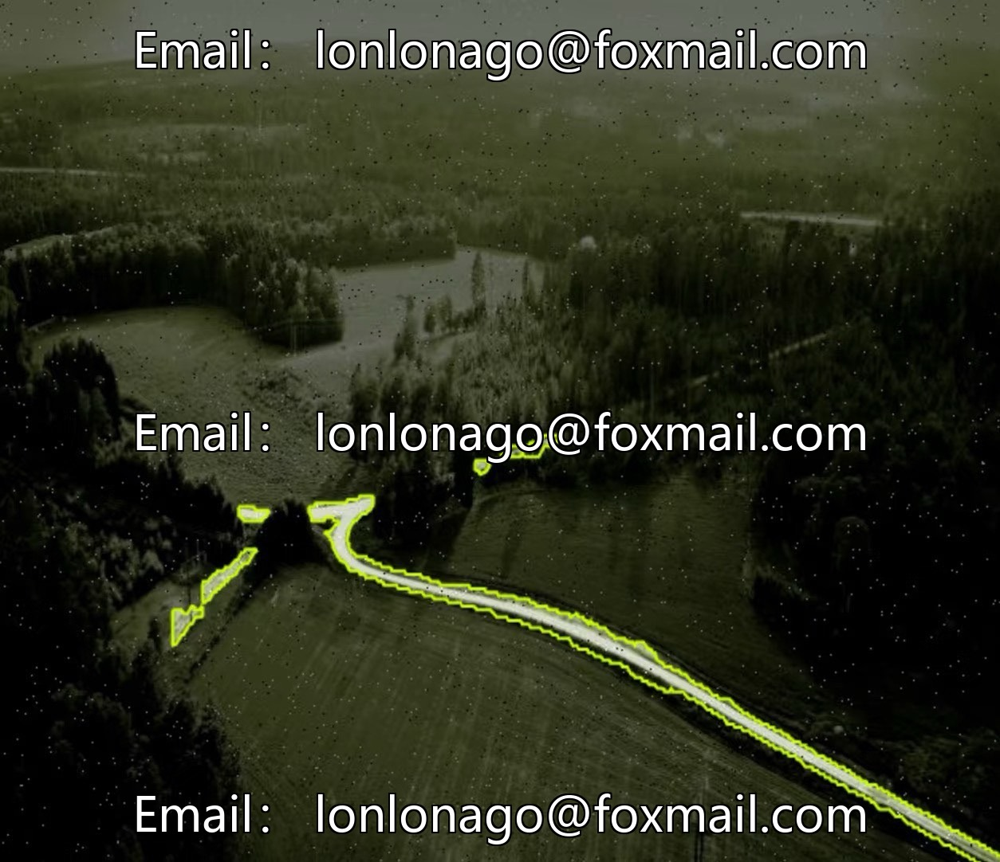
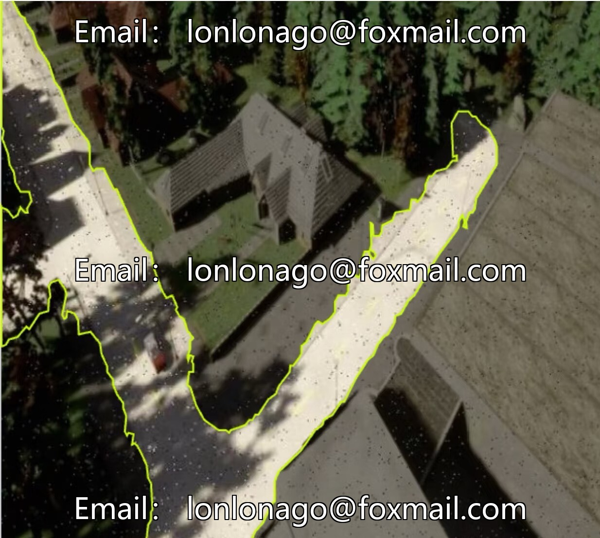
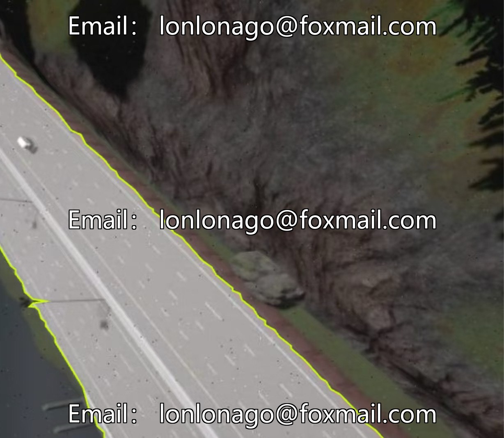

# UAV inspection and aerial photography road semantic segmentation dataset 10032 issue

## Body

UAV Inspection and Aerial Photography Road Semantic Segmentation Dataset 10032 Issue
The dataset consists of 9803 images, divided into a training set of 9017 (92%), a validation set of 269 (2.7%), and a test set of 517 (5.3%), covering urban, rural, multi-lane road scenarios. The labeling method is polygon outlines, supporting COCO and polygon formats, and includes real-world scene labels, suitable for model training and validation in intelligent driving, traffic management, map updates, etc.

The data format is JPG, with a resolution of 640×640, complete metadata and hash values, facilitating model training and performance evaluation.

Virtual materials, once sold, are non-refundable.
Interested friends, click "I want" to proceed.

## Images

## Payment

Here is a pay link on Stripe ( https://buy.stripe.com/3cs8yP7sY87d0vu9AB ). Please contact me lonlonago@foxmail.com after funding $89, and I will send you a complete data files , thank you!

